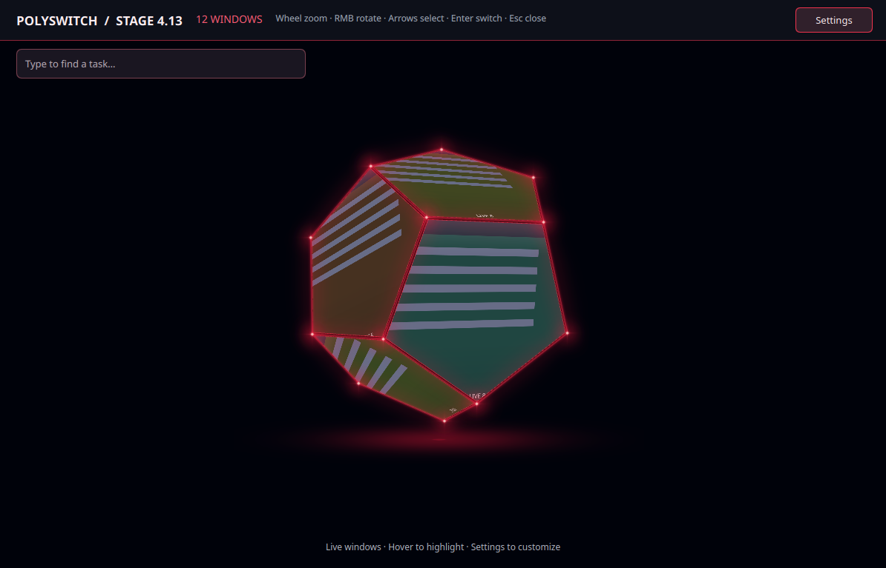
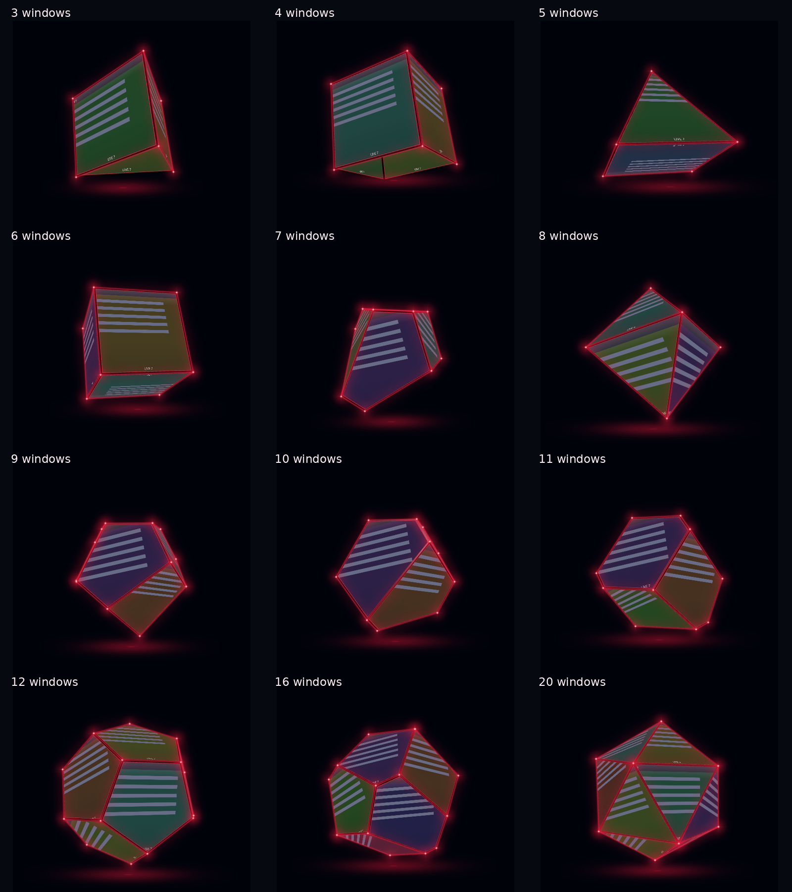
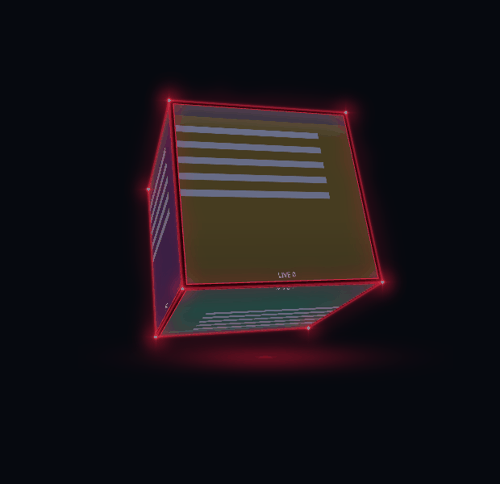
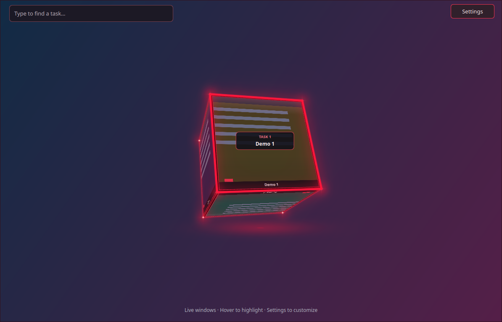
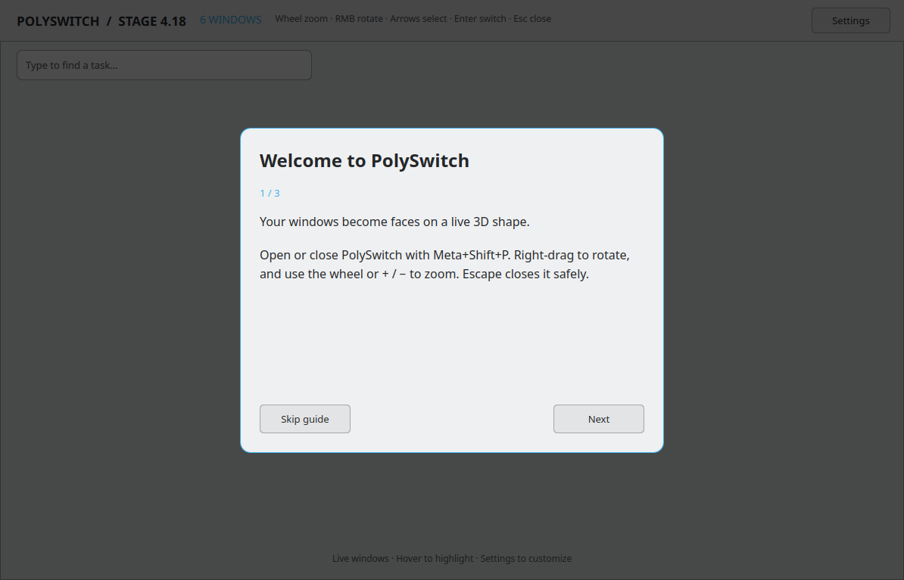
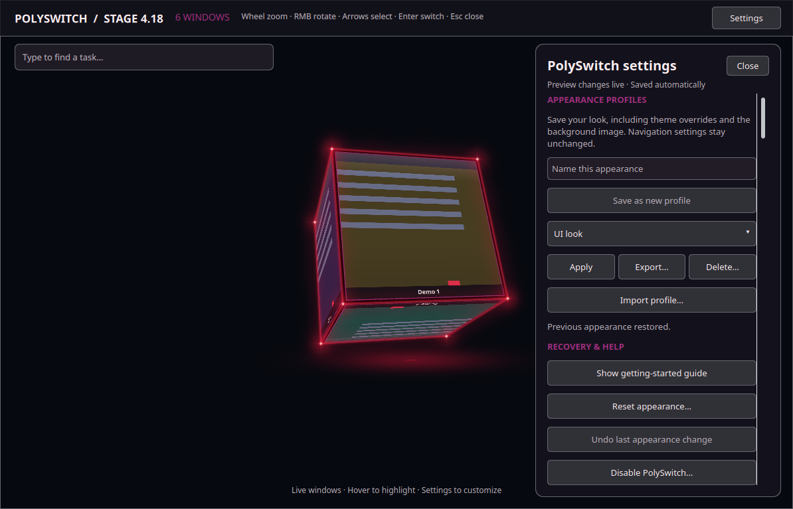

# PolySwitch

**AI-generated software:** PolySwitch was developed with AI assistance. It is an experimental project; review the source and compatibility notes before installing.

A 3D application-window switcher for KDE Plasma Wayland. Each window gets a live face on a shape that changes with the number of windows.

**Experimental native KWin plugin. Tested on KDE neon, KWin 6.8.1 and Qt 6.11.1.** Native KWin APIs and binary compatibility can change between Plasma releases. Build against the KWin installed on your machine; a compiled plugin is not a universal download.



## Features

- Live window previews, including minimized windows, with live additions, closures and title updates.
- A single panel for one window, double-sided card for two, open triangular/square arrangements for three/four, and closed solids from five onward. Six is a cube, twelve a dodecahedron, twenty an icosahedron. Other counts use convex faceted shapes, up to 64 windows.
- Screen-relative mouse rotation and momentum, wheel zoom, arrow/Tab navigation, and upright face selection.
- Type to search window titles; the best match turns toward you. Prefix matches rank first, then alphabetical order breaks ties.
- Optional smooth auto-upright roll, with an adjustable idle delay (0.2–120 seconds) and animation duration (150–3,000 ms), including with Settings open.
- Follow KDE colors automatically, with light/dark detection, live accent updates, complementary glow palettes, and automatic/manual/mixed modes with individual overrides.
- Optional Plasma SVG panels, header, search field and button accents, with independent Plasma-style colors and fallback artwork.
- Independent passive glow color, strength, spread and styles: neon, soft bloom, breathing neon and radiant edges.
- Separate hover effects: Neon, Sunlight, Ice and Breathing Neon.
- First-run guide with replay, named appearance profiles with portable import/export, undoable appearance reset, and disable/rollback tools.
- Optional header and imported local backgrounds with fill/fit/stretch and opacity controls; both persist across sessions.
- Fit/fill/title-only faces; customizable colors, titles, borders, reflection, opacity and preview quality.
- Primary-monitor display with normal mouse and keyboard use on other monitors.

Application windows only; individual browser tabs are not enumerated.

## Download a prebuilt release

The [0.4.18 release](https://github.com/windex-drinker/PolySwitch/releases/tag/v0.4.18) provides a binary archive for **KDE neon 24.04, x86_64, KWin 6.8.1, Qt 6.11.1**. This download does not require a compiler. Other systems should build from source below. The installer refuses other versions; matching version numbers alone cannot guarantee compatibility with distribution patches.

Download and extract `PolySwitch-0.4.18-neon24.04-kwin6.8.1-qt6.11.1-x86_64.tar.gz`, open a terminal in the extracted folder, then run:

```sh
./install-binary.sh --check-only
./install-binary.sh
```

This checks the archive's plugin checksum, runtime libraries and tested platform, then backs up/replaces the system plugin using KDE authentication. Save work, sign out/in normally and enable PolySwitch in Desktop Effects. Rollback/disable/uninstall scripts are included. The same release provides complete source archives under GPL-3.0-or-later.

## Build and install

Requirements: C++20 compiler, CMake 3.24+, ECM, Qt 6 Core/Gui/Widgets/Quick/Quick3D/ShaderTools, KDE Frameworks 6 CoreAddons/GlobalAccel/Config, and matching KWin development headers. QtQuick Controls, Layouts, Shapes, Effects and Quick3D runtime modules must also be available.

On KDE neon, development package names include:

```sh
sudo apt install build-essential cmake extra-cmake-modules qt6-base-dev \
  qt6-declarative-dev qt6-quick3d-dev qt6-shadertools-dev kwin-dev \
  libkf6coreaddons-dev libkf6globalaccel-dev libkf6config-dev \
  qml6-module-qtquick-controls qml6-module-qtquick-layouts
```

Package names/runtime packaging vary by distribution. Older KWin versions may require code changes.

```sh
git clone https://github.com/windex-drinker/PolySwitch.git
cd PolySwitch
chmod +x update.sh disable.sh rollback.sh uninstall.sh
./update.sh --build-only
./update.sh
```

Installation uses KDE authentication to replace the system plugin and saves the previous binary under `~/.local/share/polyswitch/backups/` (or `$XDG_DATA_HOME/polyswitch/backups/`). Close PolySwitch before installing. Save work and **sign out/in normally**, then enable **PolySwitch** in System Settings → Desktop Effects. Do not manually restart KWin or hot-load a replaced native plugin.

## Shape gallery

These are actual renders of the effect using synthetic demo windows, rather than personal application content.



This is currently a compiled native effect, not a one-click KDE Store package.

## Video demonstration

[1000026637.webm](https://github.com/user-attachments/assets/be88ae2f-02fd-43cb-a2a5-f82db63d1585)


## KDE theme following (local 0.4.16 update)

**Follow KDE Theme** is enabled by default. Automatic mode reads the active KDE application color scheme and accent, detects light/dark colors, and adapts frames, highlights, glow, lighting, text, panels and translucency. KDE color changes apply live without restarting PolySwitch. Imported image backgrounds remain your own image.

- **Automatic:** use KDE-derived colors and transparency.
- **Manual:** use the saved custom appearance. Theme changes do not overwrite these values.
- **Mixed:** follow KDE except for individual overrides. Editing a color adds an override; each color has an override checkbox. Use Clear theme overrides to return overridden roles to KDE.

Glow colors can use the accent, its complementary hue, or an analogous hue. Transparency and lighting controls also become mixed-mode overrides when edited. There are separate overrides for interface text/panels, frame/face/title colors and lighting. Mode and overrides persist across sessions.

The Plasma desktop style is detected separately. See [Plasma style investigation](docs/PLASMA-THEMES.md); SVG widget artwork is not imported into the 3D renderer.

This local update has not been uploaded to GitHub.

## Smooth live shape changes

As windows open or close, existing tasks keep their identities and move to nearby destination faces. Closed solids morph by continuously moving their boundary planes, so their faces stay joined and flat while new faces grow into place. Open rings unfold between arrangements. If another window changes during a transition, the motion continues from the current pose. Rotation/zoom stay available; face activation waits for the shape to settle.

**Smooth shape changes** and **Shape transition duration** (180–1200 ms; default 650 ms) are available in Settings. The system image picker uses the desktop portal (`xdg-desktop-portal` plus the KDE backend on Plasma).



## Header and personal backgrounds

In Settings, turn **Show header** off to hide the title/instructions bar; the search field and Settings button remain available. Use **Import background image…** to open KDE’s normal file-selection dialog, with its usual folder navigation and previews. PolySwitch temporarily closes and releases its input while the dialog is open, then returns to Settings after selection or Cancel. The obsolete embedded browser has been removed; if the system picker is unavailable, check that the KDE desktop portal is running. PolySwitch saves its own PNG copy under `~/.local/share/polyswitch/backgrounds/`, so moving or deleting the original does not break it. Images larger than 4096 pixels per side are downscaled. The picker accepts local images only; it does not upload them anywhere.

Choose fill, fit, or stretch and adjust background opacity. **Show imported background** temporarily disables it; **Remove background** returns to the background color. Header/background preferences are saved automatically and restored on the next session.



## Controls

| Action | Control |
|---|---|
| Open/close | Meta+Shift+P |
| Rotate | Right mouse drag |
| Zoom | Wheel over the shape, or + / −; 0 resets |
| Select previous/next face upright | Left/Up or Right/Down; Tab/Shift+Tab |
| Switch window | Left click face, or Enter on selection |
| Search | Start typing, or click the search field |
| Browse search matches | Up/Down or Tab/Shift+Tab |
| Close | Escape |

When search has focus, Left/Right edit the query; Up/Down browse matches. Auto-upright is an optional Settings toggle. Settings save in `~/.config/polyswitchrc` and apply live. Editing titles/settings does not send data to any service.

## Disable, roll back or remove

Close the switcher first:

```sh
./disable.sh
./rollback.sh    # restore the previous plugin saved by update.sh
./uninstall.sh   # remove this plugin, preserve preferences and backups
```

After replacing/removing native code, sign out/in normally. If the effect cannot be opened safely, disable it in Desktop Effects; `disable.sh` also records the disabled state for the next session. Keep work saved when testing an experimental compositor plugin.

## Development and tests

```sh
cmake -S . -B build-test -DPOLYSWITCH_BUILD_TESTS=ON
cmake --build build-test -j4
ctest --test-dir build-test --output-on-failure
```

The tests create an isolated temporary configuration directory. They never write to your normal PolySwitch preferences. See [validation notes](docs/VALIDATION.md) for integration coverage and [CONTRIBUTING.md](CONTRIBUTING.md) for reporting bugs.

## License

GPL-3.0-or-later. See [LICENSE](LICENSE) and [NOTICE](NOTICE), including the retained MIT notice for the original prototype. This is an independent project, not an official KDE product.

## Appearance profiles and recovery

In Settings, enter a profile name and choose **Save as new profile**. Select a saved profile to Apply, Export or Delete it. **Import profile** adds a profile without changing your current look. JSON exports include the background PNG, so recipients do not need the original image path. They preserve appearance/theme overrides; navigation and guide completion stay personal. Backgrounds larger than 16 MB must be reduced before saving a profile.

Apply and Reset appearance save one persistent recovery copy; **Undo last appearance change** restores it. Confirmation is required for reset, delete and disable. **Show getting-started guide** replays the first-run walkthrough. **Open rollback tools & instructions** opens the installed recovery helpers. See [Recovery](docs/RECOVERY.md). Save work and sign out/in normally after restoring a native plugin; never restart KWin manually.




